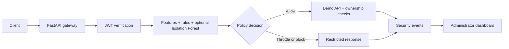

# Mega Project

## ZeroTrustAI — API Security Platform

An academic, local-first prototype exploring continuous API verification, behavioral
signals, and explainable enforcement. **Working software—not a production security
product or a claim of complete OWASP coverage.**

All implementation files live in
[`ZeroTrustAI_API_Security_Platform/`](ZeroTrustAI_API_Security_Platform/).

### What happens to a request?



### Current scope

| Implemented | Still planned |
| --- | --- |
| JWT validation and backend ownership/role checks | External identity provider and real step-up MFA |
| Rolling rate limits and temporary identity quarantine | More robust distributed-abuse detection |
| 18 numeric features and optional Isolation Forest | Autoencoder and independently labeled ML evaluation |
| Redis, PostgreSQL, live dashboard, Docker Compose | Controlled latency/throughput benchmarking |
| Automated functional tests | Production hardening and independent security review |

The current model is trained on synthetic demo data. Proposal accuracy, latency, and
throughput figures must **not** be presented as achieved results.

### Run locally

Requirements: Python 3.12+ and Docker Compose.

```bash
git clone https://github.com/Shreyashmhatre/Mega-Project.git
cd Mega-Project/ZeroTrustAI_API_Security_Platform
python3 scripts/init_env.py
docker compose up -d --build
```

Open **http://127.0.0.1:8000**. Sign in as `admin` with the generated
`ZT_ADMIN_PASSWORD` value in your local `.env`. Never commit that file.
Missing model artifacts select rules-only mode; the project README explains training.

### Documentation map

- [Setup, traffic scenarios, features, API reference, tests](ZeroTrustAI_API_Security_Platform/README.md)
- [Architecture and request lifecycle](ZeroTrustAI_API_Security_Platform/docs/ARCHITECTURE.md)
- [Threat model and deployment limits](ZeroTrustAI_API_Security_Platform/docs/SECURITY.md)
- [Implementation roadmap](ZeroTrustAI_API_Security_Platform/docs/ROADMAP.md)

### Repository layout

```text
Mega-Project/
├── .github/workflows/          # Automated tests and lint checks
├── README.md
└── ZeroTrustAI_API_Security_Platform/
    ├── common/                # Configuration and identity helpers
    ├── gateway/               # Inspection, policies, state, events, proxy
    ├── demo_api/              # Sample users, orders, ownership and roles
    ├── dashboard/             # Local HTML/CSS/JavaScript frontend
    ├── ml/                    # Offline baseline training and evaluation
    ├── traffic_simulator/     # Bounded localhost-only scenarios
    ├── tests/
    ├── docs/
    └── compose.yaml
```
